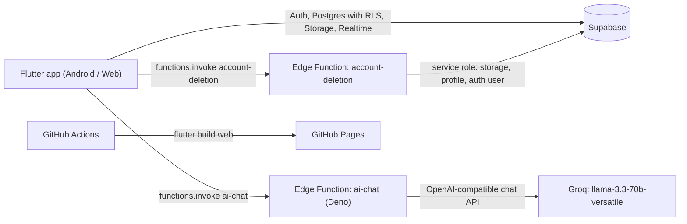

<p align="center">
  
</p>

# XPBridge

A Flutter app that connects students with real startup missions. Students build verifiable proof of work. Startups post missions, review applicants, request AI interviews, and leave mentor feedback.


**Web build:** [4waiz.github.io/XpBridge](https://4waiz.github.io/XpBridge/)

## Overview

XPBridge is a Flutter MVP that connects students with startup missions. Students build a reviewable profile with a CV, portfolio, and GitHub link, then apply to missions and earn XP as they complete them. Startups create missions, browse student profiles, review applicants, request AI interviews, and leave mentor feedback. Supabase handles authentication, profiles, mission and application data, file storage, and realtime updates. AI features run through a Supabase Edge Function, so provider keys never ship in the app.

## Features

**Students**
- Onboarding intro, then sign-up with email and password (only `@gmail.com` addresses are accepted) or **Google Sign-In** (web OAuth redirect, or the native flow on Android)
- Profile setup with CV upload, skills, portfolio and GitHub links, and weekly availability
- **Discover missions** with search and filters, a company detail view, and application submission
- **Applications** screen: status tracking and reflections (what you shipped and learned, deliverable link and type, hours spent)
- **XP and levels**: 120 XP per completed mission, 20 per reflection, and 30 per mentor review, across 10 levels
- **AI career chat** that recommends roles and matches them against open roles in the bundled sample startup data (`lib/data/dummy_data.dart`)
- **CV Builder**: describe yourself in plain English. Each AI turn returns a structured CV that renders in a live preview and exports to PDF.

**Startups**
- Company setup with website, industry, and required skills
- Create missions; browse and filter student profiles, then open their CV, portfolio, and GitHub
- Review applicants: accept, mark complete, save mentor feedback, contact by email, and **request an AI interview**

**AI interview**: four questions are built from the role and the candidate's skills. Answers get heuristic scores for communication, confidence, and relevance (word count, structure, and mission-related keywords) and an overall *Strong Fit*, *Possible Fit*, or *Needs Review* rating.

**Platform**
- **Admin console** (`profiles.is_admin = true`) to view, add, edit, and delete profiles, missions, applications, and interviews, plus preview modes to open the app as a demo student or startup
- **Guest preview**: after onboarding, logged-out users can browse the student area read-only. Any write action sends them to login.
- In-app **Privacy Policy** and **Terms** pages, a public **Delete Account** page, and account deletion that adapts to the sign-in method (password re-auth or Google re-auth)
- The `ENABLE_AI_CHAT` flag gates AI chat and the CV Builder. When it is off, those screens show "Coming Soon".

Work in progress: the Guilds, War Room, Portfolio Generator, and startup "AI talent finder" screens exist under `lib/screens/` but are not in the router yet. The guild and badge methods in `AppState` are stubs.

## Architecture



- **AI proxy:** the Flutter client sends Gemini-style `contents` and `function_declarations`. `supabase/functions/ai-chat` checks the caller's JWT, converts the request (including tool calls) to the OpenAI format for Groq, and converts the answer back. `GROQ_API_KEY` stays on the server.
- **Data model** (`supabase/schema.sql`): `profiles`, `missions`, `applications`, and `ai_interviews`, all with row-level security, plus an `is_admin()` helper. Missions, applications, and interviews are added to the realtime publication.
- **Storage** (`supabase/storage_policies.sql`): a public `xpbridge-assets` bucket with owner-scoped write policies for the `resumes/`, `profiles/`, and `logos/` prefixes.
- **Account deletion:** after re-authentication, `account-deletion` removes the user's storage files, profile row (related records cascade), and auth user with the service role key.

## Tech Stack

| Area | Technology |
| --- | --- |
| App | Flutter (Dart SDK ^3.8), go_router, supabase_flutter, google_sign_in, flutter_dotenv, file_picker, pdf + printing, google_fonts, flutter_svg, shared_preferences, url_launcher |
| Backend | Supabase Auth, Postgres (RLS), Storage, Realtime, Edge Functions (Deno) |
| AI | Groq Chat Completions (`llama-3.3-70b-versatile`) via the `ai-chat` Edge Function |
| CI/CD | GitHub Actions: Flutter web build, then GitHub Pages |

## Getting Started

**Prerequisites:** the Flutter SDK (Dart ^3.8), a Supabase project, and Node.js (for the Supabase CLI, a dev dependency in `xpbridge/package.json`).

```bash
git clone https://github.com/4waiz/XpBridge.git
cd XpBridge/xpbridge
flutter pub get
npm install                     # installs the Supabase CLI locally
```

**1. Set up the database.** In the Supabase SQL editor, run `supabase/schema.sql`, `supabase/storage_policies.sql`, and `supabase/account_deletion_migration.sql`. The `migrate_applications.sql`, `fix_profiles_schema.sql`, and `fix_missing_columns.sql` scripts upgrade older databases. `setup_demo_accounts.sql` seeds demo profiles, but it **deletes all existing profiles, missions, and applications first**. Enable email/password auth (and the Google provider if you use Google Sign-In). To make an admin, set `profiles.is_admin = true`.

**2. Deploy the Edge Functions.** Supabase provides `SUPABASE_URL`, `SUPABASE_ANON_KEY`, and `SUPABASE_SERVICE_ROLE_KEY` to functions automatically.

```bash
npx supabase login
npx supabase link --project-ref <your-project-ref>
npx supabase functions deploy ai-chat
npx supabase functions deploy account-deletion
npx supabase secrets set GROQ_API_KEY=<your-groq-api-key>
```

**3. Run the app.**

```bash
flutter run                     # connected device or emulator
flutter run -d chrome           # web
flutter analyze
flutter test
```

**4. Build for release.**

```bash
flutter build appbundle                                # Android (Play Console)
flutter build web --release --base-href "/XpBridge/"   # same command CI uses
```

For a signed Android release, copy `android/key.properties.example` to `android/key.properties` and point it at your upload keystore. Keep both files out of git. See [`xpbridge/docs/play_console_checklist.md`](xpbridge/docs/play_console_checklist.md) for the Play Console testing checklist.

## Configuration

The app reads `xpbridge/.env`, which is **bundled into the build as an asset**. Only put values here that are safe to ship to clients:

```env
SUPABASE_URL=https://<your-project>.supabase.co
SUPABASE_ANON_KEY=<your-supabase-anon-key>
STORAGE_BUCKET=xpbridge-assets
ENABLE_AI_CHAT=true
GOOGLE_WEB_CLIENT_ID=<google-oauth-web-client-id>
GOOGLE_IOS_CLIENT_ID=<optional-ios-client-id>
```

- `SUPABASE_URL` and `SUPABASE_ANON_KEY` are required. `STORAGE_BUCKET` defaults to `xpbridge-assets`. `GOOGLE_WEB_CLIENT_ID` is needed for native Google Sign-In on Android.
- `lib/config/app_config.dart` refuses to start if the file contains any key outside this allow-list. That keeps secrets such as `SUPABASE_SERVICE_ROLE_KEY`, `GROQ_API_KEY`, or other provider keys out of the client.
- Server-only secrets belong in Supabase function secrets (`npx supabase secrets set ...`).
- The GitHub Pages workflow builds with the `.env` file in the repository. If you stop committing it, have the workflow generate it from repository secrets.

## Project Structure

```
XpBridge/
├── .github/workflows/deploy.yml   # Flutter web build -> GitHub Pages
└── xpbridge/                      # Flutter project
    ├── lib/
    │   ├── main.dart              # bootstrap: env, Supabase, OAuth callback, AppState
    │   ├── app.dart               # AppState (session, data, XP/levels) and app shell
    │   ├── config/                # env loader, allow-listed config, legal/social URLs
    │   ├── routes/app_router.dart # go_router routes and role-based redirects
    │   ├── models/                # profiles, missions, applications, interviews, CV data
    │   ├── screens/               # auth, onboarding, dashboards, applications, chat, cv,
    │   │                          # interview, admin, legal, profile
    │   ├── services/              # Supabase, AI chat, CV AI + PDF, interview scoring, matching
    │   ├── widgets/               # XP design-system components
    │   └── data/dummy_data.dart   # sample startups/students used for matching and previews
    ├── supabase/
    │   ├── schema.sql, storage_policies.sql, account_deletion_migration.sql, ...
    │   └── functions/             # ai-chat, account-deletion (Deno)
    ├── docs/                      # Play Console checklist, account-deletion notes
    ├── test/widget_test.dart
    ├── android/ ios/ web/ windows/ macos/ linux/
    └── pubspec.yaml
```

## Team

- **Awaiz Ahmed** ([@4waiz](https://github.com/4waiz))
- [@Mohammad-Umar7](https://github.com/Mohammad-Umar7): Supabase auth and profiles, Google OAuth, realtime, uploads, account deletion, AI chat
- [@bilal-feroz](https://github.com/bilal-feroz): intro pages, talent page, levels, War Room, CV Builder UI, AI and PDF services

---

Built by [Awaiz Ahmed](https://github.com/4waiz) with [@Mohammad-Umar7](https://github.com/Mohammad-Umar7) and [@bilal-feroz](https://github.com/bilal-feroz)
